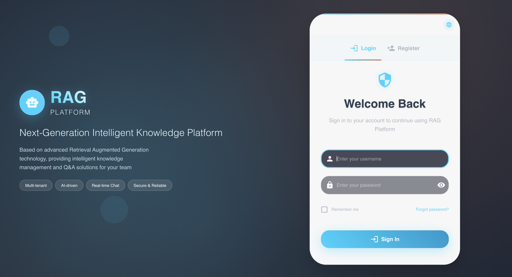
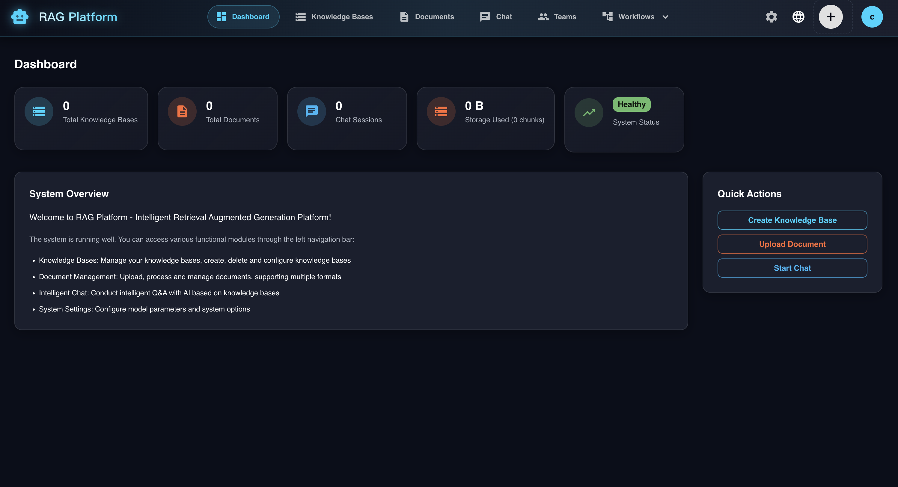
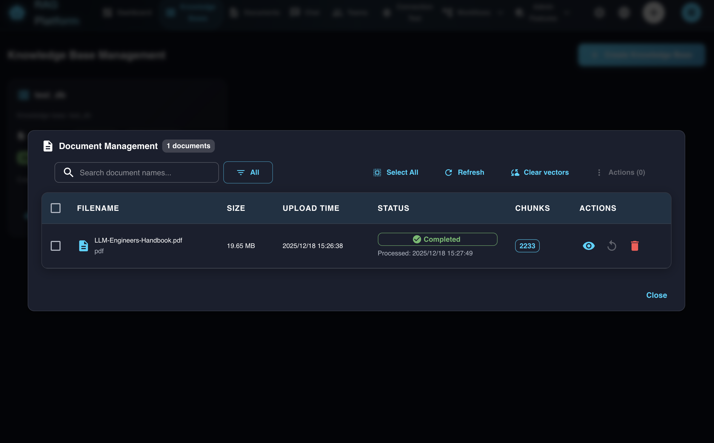
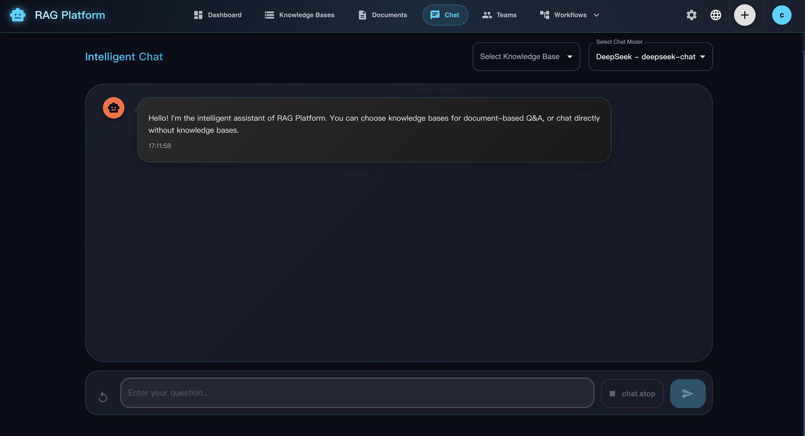
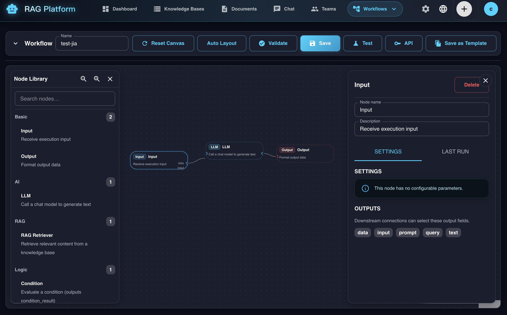
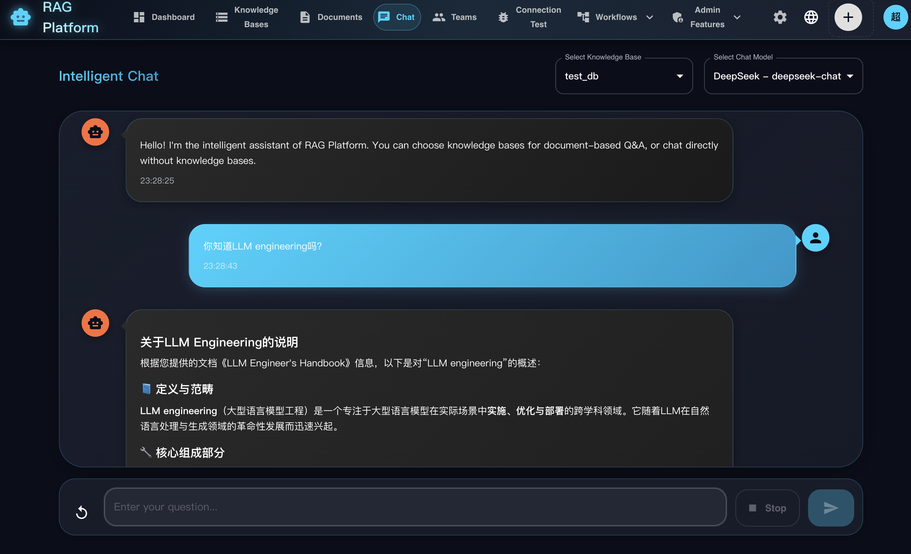

# RAG Platform

An open-source, high-performance Retrieval-Augmented Generation (RAG) platform built with Python (FastAPI) and TypeScript (React), designed for document-based AI assistants.

## 🖼️ Demo & Screenshots













## 🚀 Project Overview

This project aims to provide a powerful RAG platform inspired by systems such as Dify. It uses FastAPI for backend APIs and orchestration, alongside a modern React web interface for management and workflows.

### Core Features

- 🧠 **Intelligent Q&A:** Perform complex question answering over your documents using a RAG pipeline.
- 📚 **Knowledge Base Management:** Create and manage separate knowledge bases.
- 📄 **Multi-Format Document Support:** Upload and process multiple document formats, including `.txt` and `.md` files.
- 🔌 **Flexible API:** Use a straightforward REST API to integrate the platform with other applications.
- 🤖 **Multi-Model Support:** Integrate DeepSeek, Qwen, and SiliconFlow APIs for different use cases.
- ⚡ **High-Performance Backend:** Use FastAPI for asynchronous request handling.
- 🎨 **Modern Web Interface:** Manage the platform through a React interface built with Material UI.
- ⚙️ **Flexible Configuration:** Switch models and manage configuration settings.
- 🌍 **Internationalization:** Switch the interface between Chinese and English.

## 🌐 Public API & Embedding

The platform exposes a public API protected by an `x-api-key` header. It can be used to test workflows through chat and embed an assistant in another web page.

### Public Endpoints

All public endpoints require an API key and do not require an interactive user login.

- `POST /api/v1/public/chat` — Send a non-streaming chat request. The request body uses `ChatRequest`.
- `POST /api/v1/public/chat/stream` — Send a streaming chat request using Server-Sent Events (SSE). This is suitable for web embeds.
- `POST /api/v1/public/workflows/{workflow_id}/run` — Run a saved workflow without streaming.
- `POST /api/v1/public/workflows/{workflow_id}/run/stream` — Run a saved workflow with SSE events for started, progress, and completed states.
- `GET /api/v1/public/workflows/{workflow_id}/io-schema` — Infer the workflow-level input and output schema for integration.
- `POST /api/v1/public/workflows/{workflow_id}/execute` — Legacy alias for the `run` endpoint, retained for compatibility.

### Admin Endpoints

These endpoints manage API keys.

- `POST /api/v1/admin/api-keys` — Create an API key. Supported scopes include `chat` and `workflow`; optional restrictions include `allowed_kb` and `allowed_workflow_id`.
- `GET /api/v1/admin/api-keys` — List API keys for the current tenant.
- `DELETE /api/v1/admin/api-keys/{id}` — Revoke an API key.

### Workflow API Examples

Replace `YOUR_API_BASE_URL`, `WORKFLOW_ID`, and `YOUR_KEY` with the values from your environment.

**Run a workflow (non-streaming):**

```bash
curl -sS -X POST "YOUR_API_BASE_URL/api/v1/public/workflows/WORKFLOW_ID/run" \
  -H "Content-Type: application/json" \
  -H "x-api-key: YOUR_KEY" \
  -d '{"input_data":{"text":"hello"}}'
```

**Run a workflow (streaming with SSE):**

```bash
curl -N -X POST "YOUR_API_BASE_URL/api/v1/public/workflows/WORKFLOW_ID/run/stream" \
  -H "Content-Type: application/json" \
  -H "x-api-key: YOUR_KEY" \
  -d '{"input_data":{"text":"hello"},"debug":false}'
```

### Embedding Example

**Option 1: Use an iframe**

```html
<iframe
  src="YOUR_EMBED_URL"
  style="width: 100%; height: 560px; border: 1px solid #eee; border-radius: 8px"
></iframe>
```

**Option 2: Fetch from your own widget**

```javascript
const response = await fetch('YOUR_API_BASE_URL/api/v1/public/chat', {
  method: 'POST',
  headers: {
    'Content-Type': 'application/json',
    'x-api-key': 'YOUR_KEY'
  },
  body: JSON.stringify({
    message: 'Hello',
    knowledge_base_id: 'your_kb'
  })
});

// For streaming responses, read the SSE chunks from response.body
// and render them progressively.
```

### API Notes

- Public chat supports RAG through `knowledge_base_id` and automatically routes requests to the appropriate knowledge base for the tenant.
- Public workflow execution supports cross-tenant **public workflows**. An API key from tenant A can run a workflow owned by tenant B when that workflow is marked `is_public=true`.
- To restrict cross-tenant workflow execution, bind the API key to an `allowed_workflow_id`.
- The runtime injects execution context for isolation. The `tenant_id` is set to the workflow owner's tenant, and `user_id` is set to `0`.

## 🏗️ Architecture

The system is designed with a clear separation of concerns:

- **FastAPI Backend (Python):** Handles API requests, business logic, and orchestration.
- **React Frontend (TypeScript):** Provides the web interface and Material UI components.
- **Milvus:** Stores and retrieves document embeddings as the vector database.
- **Elasticsearch:** Provides full-text search for hybrid retrieval.
- **Multi-Model Support:** Integrates with DeepSeek, Qwen, and SiliconFlow APIs.

## 📦 Quick Start

You can start the complete stack with Docker Compose (recommended) or run the backend and frontend separately for local development.

### Prerequisites

- Python 3.9 or later.
- Docker and Docker Compose (recommended for one-command startup).
- An available Milvus instance.
- A DashScope API key for Qwen models.

### Docker Compose (Recommended)

Start the backend, frontend, MySQL, Milvus, and Elasticsearch services:

```bash
# Optional: create the root .env file for API keys and overrides
cp backend/.env.example .env

docker compose -f docker-compose.dev.yml up -d --build
```

After startup, use the frontend address and backend API documentation address configured for your environment.

Useful commands:

```bash
# Follow backend logs
docker compose -f docker-compose.dev.yml logs -f backend

# Stop the services
docker compose -f docker-compose.dev.yml down

# Remove volumes (this deletes database and vector data)
docker compose -f docker-compose.dev.yml down -v
```

### Local Setup

1. **Navigate to the backend directory.**

   ```bash
   cd backend
   ```

2. **Configure environment variables.**

   Create a `.env` file in the `backend/` directory by copying the example file:

   ```bash
   cp .env.example .env
   ```

   Edit `backend/.env` and add your credentials and connection settings:

   ```dotenv
   # DashScope API key for Qwen models
   DASHSCOPE_API_KEY="your_api_key_here"

   # Milvus connection settings
   MILVUS_HOST="localhost"
   MILVUS_PORT="19530"
   ```

3. **Install dependencies.**

   It is recommended to use a virtual environment.

   ```bash
   python3 -m venv venv
   source venv/bin/activate
   pip install --upgrade pip
   pip install -r requirements.txt
   ```

4. **Run the backend server.**

   ```bash
   uvicorn app.main:app --reload --host 0.0.0.0 --port 8000
   ```

5. **Access the API documentation.**

   Once the backend is running, open the API documentation route (`/docs`) on your configured backend host.

### Frontend Setup

The platform includes a React-based web interface.

1. **Navigate to the frontend directory.**

   ```bash
   cd frontend
   ```

2. **Install dependencies.**

   ```bash
   npm install
   ```

3. **Start the development server.**

   ```bash
   npm run dev
   ```

4. **Open the address printed by the development server** to access the web interface.

### Web Interface Features

- 📊 **Dashboard:** View system information and statistics.
- 📚 **Knowledge Base Management:** Create, delete, and manage knowledge bases.
- 💬 **Intelligent Chat:** Use an interactive chat interface with knowledge base selection.
- ⚙️ **Model Configuration:** Configure DeepSeek, Qwen, and SiliconFlow APIs.
- 📝 **Document Management:** Upload and manage documents. The original project notes identify this feature as coming soon.
- 🌍 **Language Support:** Switch between Chinese and English.

### Maintenance

Elasticsearch index mappings include `tenant_id` and `user_id` as integer fields, and `document_name` and `knowledge_base` as keyword fields. For knowledge bases created with older mappings, rebuild the Elasticsearch index using one of the following endpoints:

- `POST /api/v1/knowledge-bases/{kb_name}/maintenance/rebuild-es-index` — Recreate the Elasticsearch index only.
- `POST /api/v1/knowledge-bases/{kb_name}/maintenance/rebuild-es-index?reindex=true` — Recreate the index and reindex documents. This reparses source files, so chunking may differ from the data stored in Milvus.

### Upload Processing Options

- `UPLOAD_DIR` controls where uploaded files are stored. The default is `/tmp/uploads`.
- Set `USE_CELERY=true` and configure `CELERY_BROKER_URL` and `CELERY_RESULT_BACKEND` to process documents with a Celery worker instead of the API process.

## 🔧 API Usage Guide

This section demonstrates how to use the core RAG pipeline through the API. Replace the example base URL and credentials with values from your environment.

### Step 1: Create a Knowledge Base

Create a knowledge base. This corresponds to a collection in Milvus.

```bash
curl -X POST "YOUR_API_BASE_URL/YOUR_KNOWLEDGE_BASE_ENDPOINT" \
  -H "accept: application/json" \
  -H "Content-Type: application/json" \
  -d '{
    "name": "my_first_kb",
    "description": "A knowledge base for testing."
  }'
```

A successful response confirms that the knowledge base was created.

### Step 2: Upload a Document

Upload a `.txt` or `.md` document to the knowledge base. The system processes it in the background by chunking, embedding, and indexing its contents.

Make sure that a file named `sample.txt` exists in your current directory.

```bash
curl -X POST "YOUR_API_BASE_URL/YOUR_DOCUMENT_UPLOAD_ENDPOINT" \
  -H "accept: application/json" \
  -F "file=@sample.txt;type=text/plain"
```

The API should respond with confirmation that the file was accepted for processing.

### Step 3: Chat with Your Knowledge Base

After the document has been processed, ask questions about its contents. The system retrieves relevant context and uses the configured model to generate an answer.

```bash
curl -X POST "YOUR_API_BASE_URL/YOUR_CHAT_ENDPOINT" \
  -H "accept: application/json" \
  -H "Content-Type: application/json" \
  -d '{
    "message": "What is this document about?",
    "knowledge_base_id": "my_first_kb",
    "model": "qwen-turbo"
  }'
```

The response contains an answer generated using the content of the uploaded document.

## 🤖 Model Configuration

The platform supports multiple AI model providers for different use cases.

### Supported Providers

#### DeepSeek

- **Best for:** Code generation and technical documentation.
- **Models:** `deepseek-chat`, `deepseek-coder`.

#### Qwen (Tongyi Qianwen)

- **Best for:** Chinese-language tasks and general AI capabilities.
- **Models:** `qwen-turbo`, `qwen-plus`, `qwen-max`.

#### SiliconFlow

- **Best for:** Cost-effective embedding and reranking.
- **Models:** Various open-source models, including the BGE series.

### Configuration Presets

The web interface provides three preconfigured setups:

1. **Economic Configuration**
   - Chat: DeepSeek.
   - Embedding: SiliconFlow BGE.
   - Reranking: SiliconFlow BGE.

2. **Premium Configuration**
   - Chat: Qwen Max.
   - Embedding: Qwen Embedding.
   - Reranking: Qwen Rerank.

3. **Chinese-Optimized Configuration**
   - Chat: Qwen Plus.
   - Embedding: SiliconFlow BGE Chinese.
   - Reranking: SiliconFlow BGE Reranker.

### API Key Setup

To configure your models:

1. Open the Settings page in the web interface.
2. Choose a preset or configure the providers manually.
3. Add the API keys for the providers you want to use.
4. Test the connections.
5. Save the configuration.

### Language Support

The web interface supports Chinese and English.

- **Language switching:** Use the language icon in the top-right corner to switch between Chinese and English.
- **Automatic detection:** The system detects the browser's language preference.
- **Persistent settings:** The selected language is stored in browser `localStorage` and remembered across sessions.

#### Supported Languages

- **Chinese:** Full interface translation for Chinese users.
- **English:** Complete interface translation for English users.

The following interface elements are translated:

- Navigation menus.
- Form labels and buttons.
- Error messages and notifications.
- Help text and descriptions.
- Model configuration options.

## 📚 Modules

### 1. Document Processing

- **Formats:** PDF, DOCX, TXT, Markdown, and HTML.
- **Capabilities:** Text extraction, structure parsing, and metadata extraction.
- **Chunking:** Smart chunking, fixed-length chunking, and semantic splitting.

### 2. Vectorization

- **Embedding models:** OpenAI, Hugging Face, and local models.
- **Vector store:** Indexing and retrieval optimizations.
- **Hybrid retrieval:** Semantic and keyword search.

### 3. Q&A

- **RAG pipeline:** Retrieval followed by generation.
- **Model options:** GPT-class models, Claude-class models, and open-source LLMs.
- **Conversation context:** Multi-turn chat support.

### 4. LangGraph Workflows

- **Workflow builder:** Graph-based agent and workflow design.
- **State management:** Persistent execution state and checkpoints.
- **Multi-agent collaboration:** Agents can coordinate and communicate.
- **Conditional routing:** Route execution based on conditions.

### 5. Knowledge Base Management

- **Organization:** Hierarchical knowledge base management.
- **Access control:** Fine-grained permissions.
- **Versioning:** Document version tracking.

## 🔒 Security

### API Authentication

Generate an API key using the platform's security utility:

```python
from backend.app.core.security import generate_api_key

api_key = generate_api_key(user_id="user_123")
```

### Permissions

The following is an example permissions configuration:

```yaml
# config/permissions.yml
roles:
  admin:
    - knowledge_base: "*"
    - document: "*"
    - user: "*"
  user:
    - knowledge_base:read
    - document:upload
    - chat:query
```

## 🚀 Deployment

### Production Environment Variables

Use the following variables as a starting point for a production environment. Replace placeholder values and configure secrets securely.

```dotenv
# Database and storage
DATABASE_URL=postgresql://user:pass@db:5432/ragj_platform
REDIS_URL=redis://redis:6379/0
STORAGE_BACKEND=seaweedfs
S3_ENDPOINT=YOUR_S3_ENDPOINT
S3_ACCESS_KEY=YOUR_S3_ACCESS_KEY
S3_SECRET_KEY=YOUR_S3_SECRET_KEY
S3_BUCKET_NAME=ragj-documents

# LLM configuration
OPENAI_API_KEY=YOUR_OPENAI_API_KEY
OPENAI_BASE_URL=YOUR_OPENAI_BASE_URL

# Security configuration
SECRET_KEY=YOUR_SECRET_KEY
JWT_ALGORITHM=HS256
ACCESS_TOKEN_EXPIRE_MINUTES=30

# Service configuration
API_V1_STR=/api/v1
PROJECT_NAME=RAG Platform
DEBUG=false
```

### Monitoring

The following is an example monitoring configuration using Prometheus and Grafana:

```yaml
# docker-compose.monitoring.yml
version: '3.8'
services:
  prometheus:
    image: prom/prometheus
    ports:
      - "9090:9090"

  grafana:
    image: grafana/grafana
    ports:
      - "3001:3000"
```

## 📈 Performance

### Backend Optimizations

- Asynchronous and concurrent processing with FastAPI and background tasks.
- Batch embedding and request coalescing to reduce embedding costs.
- Tune chunking and retrieval parameters to balance quality and latency.

### Database Optimizations

```sql
-- Vector retrieval index
CREATE INDEX idx_embeddings_vector
ON document_chunks
USING ivfflat (embedding vector_cosine_ops)
WITH (lists = 100);

-- Metadata query indexes
CREATE INDEX idx_documents_kb_id ON documents(knowledge_base_id);
CREATE INDEX idx_chunks_doc_id ON document_chunks(document_id);
```

### Caching

- Redis for frequently accessed queries.
- Embedding cache.
- Document-processing result cache.

## 🛠️ Development

### Local Development

```bash
# Install development dependencies
pip install -r requirements-dev.txt

# Format the backend code
black backend/

# Run type checking
mypy backend/app/

# Run tests
pytest backend/tests/
```

### API Documentation

After starting the backend, the API documentation is available through the Swagger UI and ReDoc routes configured by the application. The OpenAPI specification is also available from the running backend.

## 🤝 Contributing

1. Create a feature branch.
2. Make your changes and commit them.
3. Run the relevant tests.
4. Submit your changes for review through your team's normal contribution process.

## 📄 License

This project is licensed under the MIT License.

---

**Note:** This is a baseline implementation suitable for learning and small deployments. For production use, harden security and tune performance for your workload.
